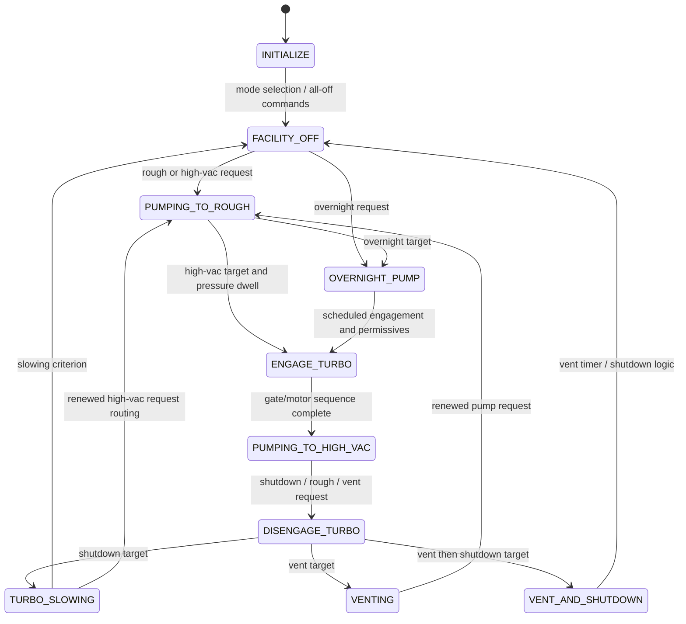

# State and command-path review

Actual software: `FacilityState` in `facility_control/model.py:24`; numeric `substate`, `target`, Auto memory, deferred requests, pending dialog and hold timers also determine behavior. Mode is a separate dimension (Initialize/Admin/Manual/Auto). Consequently the enum alone is not a complete state machine.

This is an abstraction of major routes, not exhaustive substate verification. Profile-specific routing, shared valves and global post-processing change outputs. Auto errors are handled through error flags and forced routing, not explicit FAULT/RECOVERY enum states. Normal exit has its own controller path; crash cleanup is different.

Proposed model: BOOT_UNKNOWN -> RECOVERY -> confirmed OFF -> ROUGHING -> STARTING -> PUMPING -> STOPPING -> confirmed OFF, with separately authorized VENTING. Any loss of a required permissive enters latched FAULT; FAULT -> RECOVERY only after acknowledgement, cause clearance and fresh physical reconciliation. Recovery is not proof that all devices are off. All edges require current qualified telemetry and confirmed preceding actuator state. Exact fault outputs/vent conditions remain unresolved pending plant specifications.

| Command path | Present enforcement | Gap |
|---|---|---|
| GUI Manual -> request queue -> dialog | Interlocks checked before asking; limited final backing-valve guard | Confirmation can use obsolete permissive (F07) |
| GUI/Admin or `request_admin_mode` + `request_user_cmd` | Warnings, confirmation; no mandatory general interlocks | Deliberate bypass (F02) |
| Auto button API | Auto state machine and global pressure/exposure rules | Buttons collected into a set; ordering between conflicting actions discarded; no formal command priority contract |
| `request_set_threshold` | Float conversion | NaN/infinity/negative accepted (F04) |
| `request_clear_error` | Clears computed error and trip latches before deciding | Active fault can disappear for that decision cycle; persistent-fault recovery needs tests/repair |
| HAL `write`, `safe_state`, direct serial tools | Direct output/protocol control | No centralized interlock barrier; tools must be treated as privileged commissioning access |
| orderly GUI exit | Auto shutdown sequence | Depends on application still running and trustworthy inputs |
| exception/request_stop | `_shutdown` writes and sleep | No physical closure confirmation; absent speed can remove services; no hard-kill guarantee |
| backend open / process restart | NI backend calls all-off `safe_state` | Occurs before plant reconciliation (F08) |

Requests are thread-safe queued, and GUI snapshots use a lock; this does not make multi-device writes atomic. An asynchronous serial worker has a separate desired/applied state and telemetry cache. `Commands` denotes demand; NI writes are sequential and D-SUB motor feedback echoes the command. A single valve open contact cannot prove a closed seat, distinguish cable loss from closure, or detect leakage. Treat these as unavailable evidence, not confirmed closed.

Application failure boundary: protection against rapid atmospheric inrush, loss of backing/cooling, pneumatic/power failure and unsafe DAQ retained/default outputs must be independently allocated to the controller, hardware interlock, mechanical design and/or maintained services. No independent protection has been established from this repository. A Python `finally` block, GUI confirmation or loop watchdog running on the same computer cannot cover hard power loss.
